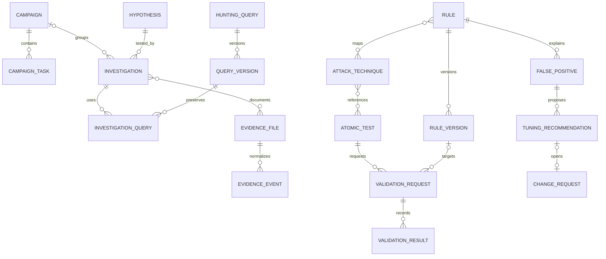

# Expansão HadSec: planejamento inicial (histórico)

Este documento registra o planejamento inicial da fase visual. Ele foi sucedido pela implementação funcional e pelas migrações 0010–0026 descritas em [functional-modules.md](functional-modules.md). O usuário autorizou a publicação após a conclusão dos testes em 09/11/2026. As propostas abaixo são contexto histórico, não o estado atual dos módulos.

## Base existente

React 19 e Vite 6; navegação por hash; lucide-react; CSS próprio; editor compartilhado; PDF com jsPDF. Supabase fornece Auth e PostgreSQL, com RLS, perfis globais e exceções individuais. Operações de negócio usam RPCs; o gateway `/api/gateway` verifica sessões no servidor e integra GitHub e validação estática. Não há necessidade de trocar o framework nem instalar outra biblioteca de componentes.

Reutilizar `profiles`, `roles`, `user_permission_overrides`, `permission_definitions`, `rules`, `rule_versions`, `change_requests`, `test_evidence` e `audit_events`. Preservar a aprovação independente do administrador, exclusões autorizadas, versões imutáveis, histórico original, PDF e laboratório multiformato. As três alterações locais anteriores em detection-engine, filter-expression e seus testes ficam preservadas.

## Navegação e entrega local

Ordem: Dashboard; Rule Management; Detection Coverage; Hunting Investigation; Hunting Campaigns; False Positive Intelligence; Hunting Query Library. Configurações e perfil continuam no final da barra.

| Rota | Conteúdo |
| --- | --- |
| `#dashboard` | Resumo consolidado com os dados atuais reais de regras e solicitações; acesso aos módulos |
| `#overview`, `#requests`, `#rules`, `#reports`, `#lab` | Fluxos existentes agrupados em Rule Management |
| `#coverage` | Estrutura da cobertura, referências MITRE das regras internas, catálogos e testes |
| `#investigations` | Estrutura para hipóteses, evidências e timeline |
| `#campaigns` | Estrutura para campanhas, tarefas e Kanban |
| `#false-positives` | Estrutura da base e recomendações de tuning |
| `#query-library` | Estrutura da biblioteca, versões e utilização |

A fase 1 permite revisar organização, layouts responsivos e navegação. As telas novas identificam o que aguarda implementação; não exibem campanhas fictícias, sincronizações inventadas ou cobertura validada sem evidência. Não inclui cadastro operacional nesses módulos. Rotas antigas continuam disponíveis. O acesso continua exigindo login real.

## Modelo de dados proposto

Tabelas com UUID, autor, timestamps UTC e controle de concorrência. Relacionamentos têm FKs e índices; exclusões operacionais usam arquivamento para preservar evidências. Os catálogos mantêm revisões identificáveis, sem sobrescrever a origem utilizada em testes antigos.

| Entidades | Campos e relações principais |
| --- | --- |
| `catalog_syncs` | fonte permitida, URL oficial, commit/versão, domínio, licença, hash, data, estado e erros; promoção atômica somente após validar importação |
| `attack_tactics`, `attack_techniques`, `attack_technique_tactics` | STIX ID, external ID, domínio, nome, descrição, parent/subtécnica, plataformas, revogado/depreciado, revisão de origem |
| `rule_techniques` | regra existente × técnica, origem e justificativa do mapeamento; o texto legado `rules.technique` continua preservado |
| `sigma_rules`, `sigma_rule_revisions`, `sigma_rule_techniques`, `sigma_internal_rules` | ID oficial, metadados pesquisáveis, logsource, YAML original, hash/commit/licença; vínculos internos explícitos; candidatos a duplicação por UUID/hash e título, nunca mescla automática |
| `atomic_tests`, `atomic_test_revisions`, `atomic_test_techniques` | GUID oficial, técnica, plataformas, executor, descrição, requisitos, comandos e limpeza como texto, revisão original |
| `validation_requests` | referência Atomic e revisão, técnica, regra/versão, solicitante, responsável, ambiente, objetivo, justificativa, estado, revisão e `retest_of` |
| `validation_results` | solicitação, execução em UTC, execução sucesso/falha, detecção sim/não/desconhecida, ambiente, observações, revisor e referências às evidências; imutável |
| `campaigns`, `campaign_members` | nome, objetivo, justificativa, escopo, início/fim, responsável, participantes, prioridade, fontes necessárias, critérios de conclusão, status, resultados e recomendações |
| `hypotheses`, `investigations` | hipótese descreve comportamento, justificativa, técnicas e expectativa; investigação registra uma execução da hipótese, campanha opcional, responsável, prioridade, escopo, metodologia, status, conclusão e recomendações |
| `campaign_tasks` | campanha, responsável, prioridade, prazo, estado; FKs opcionais para investigação, consulta, solicitação Atomic e regra; comentários e evidências relacionados |
| `evidence_files`, `evidence_events` | objeto privado original, nome seguro, tamanho, MIME, SHA-256 verificado no servidor, origem/adaptador e autor; eventos normalizados separados do original com índice de linha, host, usuário, IPs, data, event ID, técnica e regra |
| `investigation_queries` | investigação × versão exata de consulta, observações, resultados e limitações; não apenas referência à versão corrente |
| `false_positives`, `false_positive_occurrences`, `tuning_recommendations` | regra e versão analisada, ferramenta, alerta, comportamento, causa, hosts/aplicações, técnicas, categoria, evidências, analista, data, recomendação, justificativa de exceção e revisão; ocorrências preservadas antes/depois; solicitação de alteração existente vinculada |
| `hunting_queries`, `hunting_query_versions`, `query_comments`, `query_favorites` | metadados, tecnologia, linguagem, código imutável por versão, objetivo, fontes, campos esperados, tags, categoria, exemplos, autor, nota de alteração; favoritos por usuário |
| tabelas de associação | campanhas/hipóteses/investigações × técnicas; campanhas × consultas; evidências × investigações/tarefas/resultados/falsos positivos; referências explícitas e sem IDs polimórficos sem FK |

## Regras operacionais

- Cobertura é uma visão derivada por domínio/técnica/ambiente e versão da regra: sem regra; regra sem validação; teste solicitado; executado sem detecção; validada; desconhecida/insuficiente. A matriz permite inspecionar resultados conflitantes e antigas versões, sem ocultá-los em um único percentual. Validação estática ou simulação local não comprova detecção real.
- O escopo inicial da matriz será Enterprise ATT&CK. Mobile e ICS ficam como filtros futuros de domínio, sem misturar denominadores. Navigator recebe layer JSON com versão/schema e domínio explicitados e validados.
- Atomic: rascunho → aguardando aprovação → aprovado → em execução → aguardando validação → concluído. Rejeitado, cancelado e falha de execução têm justificativas. Apenas transições autorizadas no banco. Sem runner, shell, endpoint ou execução remota.
- Tarefas: pendente → em andamento → em revisão → concluída; bloqueada/cancelada com motivo. Kanban atualiza pela mesma RPC de transição, com alternativa acessível por select.
- Query Library armazena e versiona texto; não executa nos SIEMs. Comparação por versão, comentários, favoritos pessoais e import/export JSON. Tecnologias e linguagens são campos distintos; não promete conversão entre plataformas.
- Falso positivo gera recomendação e pode abrir `submit_change_request` com vínculo. Nenhum filtro, exceção ou threshold é aplicado sem revisão. Taxas exigem denominador real; contagens de ocorrências documentadas são indicadores distintos.

## Segurança e importação

Adicionar permissões `coverage.read`, `catalogs.manage`, `validation.request`, `validation.approve`, `validation.record`, `hunting.read`, `hunting.write`, `campaigns.manage`, `evidence.read`, `evidence.write`, `false_positives.write`, `queries.write`, `queries.share`. Ampliar constraints de permissões existentes em migração própria; herança global e exceções individuais permanecem. Administrador recebe os novos direitos explicitamente; não conceder automaticamente tudo a leitores.

Aplicar RLS e checks RPC às tabelas novas; leitura da evidência exige acesso ao registro pai e `evidence.read`. Gestores e membros autorizados acessam campanhas/investigações; usuários desativados, anônimos e contas aguardando troca de senha não acessam. Auditoria registra criação, revisão, transição, importação, acesso/exportação de evidências e arquivamento, sem copiar conteúdo sensível para metadados de notificações.

Usar Supabase Storage privado, sem URL pública. Downloads autenticados ou URLs curtas somente após autorização. Upload inicial proposto: 10 MB por arquivo, 5.000 eventos por importação, UTF-8 JSON/NDJSON/CSV; validação no servidor de extensão, MIME, tamanho real, linhas, profundidade e limites de campos. SHA-256 calculado sobre bytes originais e confirmado no servidor antes de finalizar o registro. Sem armazenamento de base64 na tabela de eventos. Upload incompleto não aparece como evidência confirmada; limpeza de órfãos auditada.

Adaptadores versionados para Chainsaw, Hayabusa e Velociraptor; prévia de mapeamento, datas com timezone explícito, relatório de linhas inválidas e importação transacional. Nenhuma normalização altera o original. CSV exportado protege contra fórmulas. React renderiza dados como texto; HTML/Markdown não confiável e comandos nunca são executados. EVTX é recusado até existir parser isolado adequado. Proximidade temporal não cria automaticamente relação maliciosa.

Catálogos sincronizados apenas por administrador, a partir de allowlist oficial com commit fixado e limites por lote. YAML já disponível é reutilizado com limites de aliases/profundidade. Guardar licença e atribuição por origem. Manter snapshot anterior se fonte estiver indisponível ou importação falhar. Sem copiar aplicações inteiras de terceiros, sem API paga e sem baixar comandos para executá-los.

## Etapas e critérios de aceite

1. **Estrutura local (esta revisão):** ordem do menu, rotas próprias, Dashboard com dados existentes, layouts dos módulos, modelo de dados e planejamento. Teste desktop/mobile e regressão do fluxo atual. Sem migração remota ou deploy.
2. **Coverage e catálogos:** migrações aditivas, permissões, ingestão oficial com proveniência, matriz com lacunas, Sigma e Atomic, solicitações/revisão/resultados, evidências e export Navigator. Testar snapshots inválidos, falha externa e transições indevidas. Integração a motor nativo continua manual.
3. **Campanhas e biblioteca:** CRUD, participantes, tarefas/Kanban, prazos, query editor, versões/diff, favoritos, comentários, JSON e vínculos. Testar concorrência, isolamento de acesso e invariância de versões usadas.
4. **False Positive Intelligence:** ocorrências, filtros, recomendações/revisão, vínculo a tuning e reteste; comparar versões e datas sem inventar taxa. Testar permissões e preservação do histórico.
5. **Investigações/evidências:** hipóteses, execuções, importação estruturada dos três adaptadores, armazenamento privado, hashes, timeline e relatórios PDF. Testar arquivos inválidos, limites, autorização, timezone, exportação e integridade original.
6. **Consolidação:** Dashboard de todos os módulos com denominadores reais, relatório de campanha, notificações com destinos corretos, auditoria e regressão integrada dos fluxos A/B/C. Revisão local do usuário antes de publicar.

Pode começar imediatamente com as dependências gratuitas existentes. Depende das próximas fases: migrações autorizadas e Storage privado; sincronização real de catálogos; amostras exportadas das ferramentas para validar adaptadores. Depende de integração futura fora deste escopo: parser EVTX, acesso direto a SIEM/endpoints e compilação/execução nativa remota.

## Riscos de integração e mitigação

| Risco | Mitigação |
| --- | --- |
| Crescimento de catálogos e evidências no plano gratuito | Paginação/filtros no servidor, ingestão incremental, orçamento de armazenamento e limites explícitos; não ampliar `loadData()` para baixar tudo |
| Migração afetar regras atuais | Migrações aditivas por fase, testes PostgreSQL/PGlite, fixtures temporárias, sem reescrever versões existentes |
| Conteúdo externo alterar formato/licença | Adaptadores separados e versionados, snapshots e testes de contrato; falha mantém último catálogo válido |
| Falsa sensação de cobertura | Distinguir associação, análise estática, execução e detecção observada com ambiente/data/versão |
| Vazamento de logs/evidências | RLS por recurso, bucket privado, URLs curtas, autorização servidor, nunca tokens no bundle |
| Navegação romper testes/links antigos | Preservar hashes antigos e fluxos; nova rota inicial Dashboard; regressão com login e evidências |

## Referências oficiais consultadas

- ATT&CK Navigator: https://github.com/mitre-attack/attack-navigator
- Dados ATT&CK (STIX): https://github.com/mitre-attack/attack-stix-data
- SigmaHQ: https://github.com/SigmaHQ/sigma
- Atomic Red Team: https://github.com/redcanaryco/atomic-red-team
- Chainsaw: https://github.com/WithSecureLabs/chainsaw
- Hayabusa: https://github.com/Yamato-Security/hayabusa
- Velociraptor: https://github.com/Velocidex/velociraptor

O anexo exige: “Não implementar todas as fases de uma vez sem antes apresentar e validar o planejamento.” Esta revisão entrega a fase 1 para essa validação. As fases 2–6 e a publicação permanecem pendentes de aprovação.
